<h1 align="center">💙 Hi, I'm Kashish Rai</h1>

<h3 align="center">
  Aspiring Data Scientist | Machine Learning Enthusiast | AI Explorer
</h3>

  

  

---

## 👩‍💻 About Me

- 🎓 Pursuing B.E. in Computer Science Engineering.
- 🐍 Intermediate Python Programmer.
- 📊 Interested in Data Science and Data Analytics.
- 🤖 Passionate about Machine Learning and Artificial Intelligence.
- 💡 Learning and implementing different Machine Learning algorithms.
- 🌱 Currently exploring AI, Deep Learning and TensorFlow.
- 🎯 Open to Data Science and AI/ML internship opportunities.

---

## 💻 Programming Languages

  

  

---

## 🛠️ Tools & Technologies

  

  
  
  
  

---

## 📚 Data Science & Python Libraries

  
  
  
  

---

## 🤖 Machine Learning Techniques

  
  

**Regression Algorithms**
- Linear Regression
- Multiple Linear Regression
- Polynomial Regression
- Logistic Regression

**Classification Algorithms**
- Decision Tree
- Random Forest
- Naive Bayes
- Support Vector Machine (SVM)
- K-Nearest Neighbors (KNN)

**Clustering Algorithms**
- K-Means Clustering
- Hierarchical Clustering

**Other Concepts**
- Model Training & Prediction
- Data Preprocessing
- Feature Engineering
- Model Evaluation
- Accuracy, Precision, Recall & F1-Score
- Mean Squared Error (MSE)

---

## 🌱 Currently Learning

  
  
  
  

---

<h2 align="center">📊 GitHub Statistics</h2>

<picture>
  <source media="(prefers-color-scheme: dark)" srcset="./assets/cards.dark.svg" />
  
</picture>

 

  

 

  

---

## 🌐 Connect With Me

  

  

---

<h3 align="center">💙 Learning | Building | Growing</h3>

  <i>"Turning data into insights and ideas into intelligent solutions."</i>

  ⭐ Thanks for visiting my GitHub profile!

